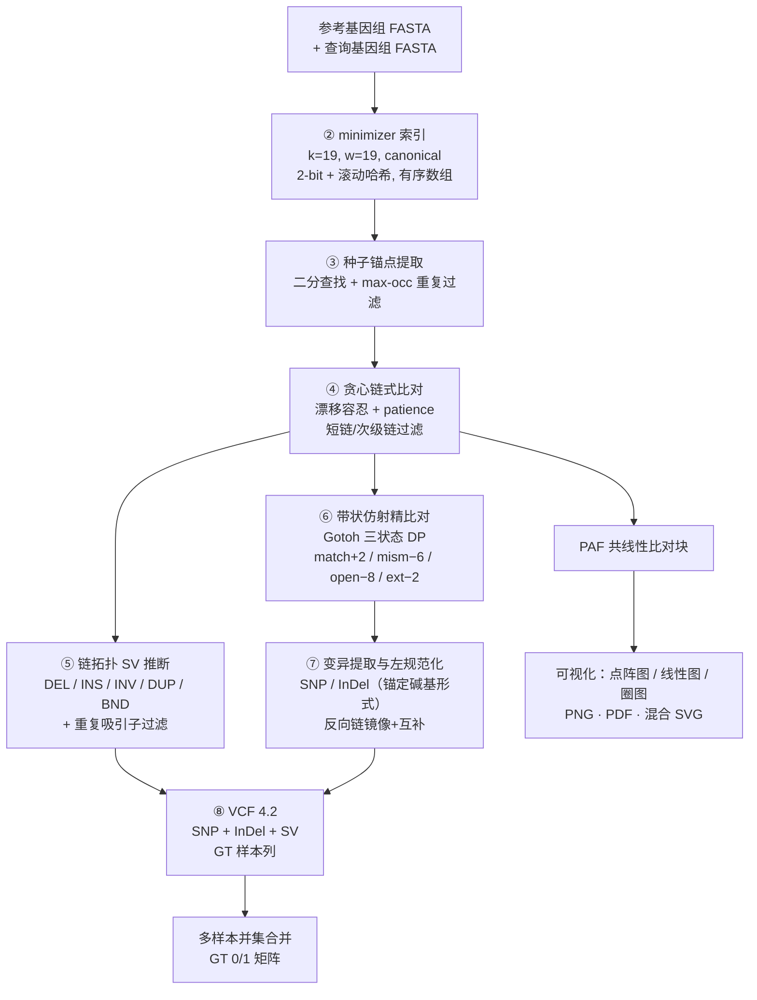

# genodiff 技术文档：底层逻辑、运行流程与使用教程

> 面向科研论文的程序流程描述、创新点对比与完整使用教程。
> 版本：M4.2 | 语言：Rust（无第三方依赖）| 许可与源码见仓库

---

## 1. 软件定位

genodiff 是一个**从零实现**的参考引导基因组比较工具：输入两个（或多个）
单倍体组装基因组 FASTA，一次性输出 SNP / InDel / 结构变异（SV）的
标准 VCF 4.2 文件，以及出版级的共线性可视化（点阵图 / 线性图 / 圈图）。
不依赖 minimap2、MUMmer、Syri 等任何外部比对或变异检测工具。

## 2. 底层逻辑（程序图素材）

整条流水线分 **8 个阶段**。前 4 个阶段为比对层（可单独通过 `map` 子命令
输出 PAF），后 4 个阶段为变异层（由 `call` 子命令一次完成 1→8）。

### 阶段总览（绘制程序图用）

```
┌────────────────────────────────────────────────────────────────────┐
│ ① 输入层                                                            │
│    参考基因组 FASTA + 查询基因组 FASTA（单倍体组装，任意 contig 数）   │
└──────────────┬─────────────────────────────────────────────────────┘
               ▼
┌────────────────────────────────────────────────────────────────────┐
│ ② 参考索引（minimizer index）              [index 子命令 / call 内建] │
│    canonical minimizer 采样：k=19, w=19                             │
│    · 2-bit 碱基打包 + 双向链滚动哈希（正反向 k-mer 同值）              │
│    · 哈希 → (contig, pos, strand) 单一有序数组，二分查找              │
│    · 磁盘格式 .gdx：建一次，对任意多个查询复用                        │
│    输出：约 24 B/minimizer 的紧凑索引（800 Mb ≈ 2 GB）               │
└──────────────┬─────────────────────────────────────────────────────┘
               ▼
┌────────────────────────────────────────────────────────────────────┐
│ ③ 种子锚点提取（seeding）                                            │
│    查询流式提取同参数 minimizer → 索引二分查找                        │
│    · --max-occ：出现次数超阈值的锚点丢弃（高频重复第一道闸）           │
│    输出：锚点 (qpos, rpos, strand) 流                                │
└──────────────┬─────────────────────────────────────────────────────┘
               ▼
┌────────────────────────────────────────────────────────────────────┐
│ ④ 贪心链式比对（chaining，含 patience 容忍）                          │
│    · 相邻锚点 |Δref−Δquery| ≤ max(150, Δq/8)（上限 2000）则共线延伸   │
│    · patience 窗口（默认 1000bp）：中频重复的离群种子被跳过而非断链     │
│    · pending 机制：断点收紧在接合处                                   │
│    · 过滤：min_anchors=25 / min_span=500 / 次级链抑制（≥50% 查询重叠）│
│    输出：共线性比对块（PAF 格式；倒位块自动呈反向）        [map 子命令] │
└──────────────┬─────────────────────────────────────────────────────┘
               ▼
┌────────────────────────────────────────────────────────────────────┐
│ ⑤ 链拓扑 SV 推断（sv.rs）                                            │
│    相邻链的断点几何 → 五类 SV（DEL/INS 要求两侧间隙均 ≤100kb，        │
│    Mb 级单侧间隙 = 错配链对/大重排签名，不判为位点级 SV）：            │
│    · 同链体 ref 间隙 > query 间隙        → DEL                        │
│    · 同链体 query 间隙 > ref 间隙        → INS                        │
│    · − 链两侧为 + 链且参考区间贴合       → INV（对称间隙判据桥接       │
│       任意长度的共享重复侧翼）                                        │
│    · 同链体参考区间重叠                 → DUP（串联/片段重复）        │
│    · 相邻链跨参考染色体（双侧 ≥100 锚点  → BND/易位                   │
│      且查询间隙 ≤5kb）                                               │
│    · 重复吸引子过滤：16kb 参考 bin 被 ≥5 条互距 ≥50kb 的查询链命中     │
│      → 判为旁系比对，整组剔除                                         │
└──────────────┬─────────────────────────────────────────────────────┘
               ▼
┌────────────────────────────────────────────────────────────────────┐
│ ⑥ 带状精比对（banded Gotoh alignment）                               │
│    相邻锚点之间的间隙序列做三状态仿射间隙 DP：                         │
│    match +2 / mismatch −6 / gap open −8 / gap extend −2              │
│    带宽 = |m−n| + 24 + min(m,n)/6（随机序列与无带暴力实现逐对对拍验证）│
└──────────────┬─────────────────────────────────────────────────────┘
               ▼
┌────────────────────────────────────────────────────────────────────┐
│ ⑦ 变异提取与规范化                                                    │
│    · Mismatch 列 → SNP（N 碱基列跳过）                                │
│    · Del/Ins 运行 → 显式 InDel（锚定碱基形式）                        │
│    · 种子重叠滑移 → 重叠区内等长 indel（长度精确，位置由左规范化钉住）  │
│    · 全部 indel 左对齐规范化（同聚物表示唯一化）                       │
│    · 反向链：坐标镜像 + 碱基互补，VCF 等位基因统一在参考正链            │
│    · 链拓扑 SV（DEL/INS/INV/DUP/BND）带 SVTYPE/END/SVLEN              │
│    · DEL/INV/DUP 是参考已知序列 → 符号记录只描述位置与长度，           │
│      序列可按 POS+END 从参考还原；仅 INS（外来序列）写出碱基           │
│      （≤ --sv-seq-cap，默认 100kb，超过转 <INS> 符号）                 │
│    · INS/INV/DUP 附 QSEQ/QSTART/QEND：区段在查询基因组的 1-based 坐标，│
│      faidx 可直接提取；##reference/##genodiff_query 记录两个基因组文件 │
│    输出：VCF 4.2（GT 样本列，单倍体 GT=1）                [call 子命令]│
└──────────────┬─────────────────────────────────────────────────────┘
               ▼
┌────────────────────────────────────────────────────────────────────┐
│ ⑧ 多样本合并与可视化                                                  │
│    · merge_vcfs.py：N 个单样本 VCF 并集合并 → 多样本 VCF              │
│      （GT=1 携带 / GT=0 参考）                                       │
│    · plot_syntenic_dotplot.py / plot_syntenic_linear.py /            │
│      plot_syntenic_circos.py：PAF → 点阵图 / 线性图 / 圈图            │
│    · plot_region_synteny.py：区域共线性轨道图（区域投影到各基因组，   │
│      相邻基因组连线，倒位交叉显示）                                    │
│    · SVG 混合导出：900dpi PNG 底图 + 可编辑 <text>（严格对齐）         │
└────────────────────────────────────────────────────────────────────┘
```

### Mermaid 流程图（可直接渲染成论文图）



### 各阶段关键参数

| 阶段 | 参数 | 默认值 | 作用 |
|---|---|---|---|
| ② 索引 | `--k` / `--w` | 19 / 19 | k-mer 长度 / 窗口；分歧 <5% 用默认，更远用 15/10 |
| ③ 种子 | `--max-occ` | 100 | 高频重复锚点丢弃阈值 |
| ④ 链式 | `--drift` | 150 | 相邻锚点基础漂移容忍（bp） |
| ④ 链式 | `--max-gap` | 100000 | 查询方向断链距离 |
| ④ 链式 | `--min-anchors` / `--min-span` | 25 / 500 | 短链过滤 |
| ④ 链式 | `--patience` | 1000 | 非延伸种子容忍窗口（bp） |
| ⑤ SV | `min_sv_len` | 50 | SV 最短长度 |
| ⑥ 比对 | `max_align_len` | 2000 | 间隙碱基比对的长度上限 |
| 通用 | `--threads` | 全核 | 按 contig 并行 |

## 3. 创新点与同类软件对比

### 3.1 与主流流程的对比

| 维度 | genodiff | minimap2 + Syri 流程 | MUM&Co | paftools.js call |
|---|---|---|---|---|
| 外部依赖数 | **0**（单一静态二进制） | ≥4（minimap2、Python3、NumPy/SciPy/Matplotlib/NetworkX/Pysam） | MUMmer 3/4 + Python | minimap2 + Node/Python |
| 一条命令 FASTA→VCF | **是**（`call`） | 否（比对、过滤、Syri 分析、格式转换多步拼装） | 是（仅 SNP/小 InDel 为主） | 是（仅 SNP/小 InDel） |
| 组装对组装专项优化 | **是**（无读段比对机制负担） | 部分（minimap2 为读段/组装通用） | 是 | 部分 |
| SV 类型 | DEL/INS/INV/DUP/BND | DEL/INS/INV/DUP/TRA（分类更细） | 部分 | 不支持 |
| 输出 | **直接 VCF 4.2（已左规范化）** | 自有 .out/.vcf/.bed 多格式 | VCF | VCF（gap 层） |
| 中频重复断链鲁棒性 | **patience + 对称间隙桥接** | DP 链式内置 | 弱 | 弱 |
| 旁系比对过滤 | **重复吸引子 bin 过滤** | mapq 体系 | 无 | 无 |
| 多样本并集合并 | **内置** | 需 bcftools 等 | 无 | 无 |
| 内存形态 | 有序数组 ~24B/minimizer，O(1) 链状态 | minimap2 索引 + SAM 中间文件 | delta 中间文件 | — |
| 校验体系 | 内置模拟器 + 45 项测试 + 对拍脚本 | 上游测试 | 无 | 无 |

### 3.2 创新点（论文可用表述）

1. **单二进制零依赖全流程**：一个纯 Rust 静态二进制完成“FASTA 入 →
   VCF 出”，无解释器、无第三方库、无中间 SAM/PAF 格式转换层，
   消除了多工具拼装流程中最主要的安装与版本兼容成本。
2. **面向单倍体组装比较的专用架构**：绕开销毁式读段比对的参数体系，
   比对层直接以“共线性锚点链”为一等工作对象，链即比对块、链即 SV
   候选，层间零格式转换。
3. **patience 断链容忍**：贪心链式对“无法延伸的种子”保持 1kb 容忍窗口，
   解决植物基因组中频重复导致的链碎片化（真实 800 Mb 数据上把无效
   断链从 1.03×10⁷ 降至 5.2×10⁵，入链锚点 +50%），同时真实 SV 处
   仍正常断链、断点由 pending 机制保持在接合处。
4. **对称间隙倒位判据**：倒位侧翼允许被任意长度的共享重复隔开
   （query 侧间隙与 ref 侧间隙长度相等即视为同一间隔序列），
   突破固定 tolerance 对侧翼长度的限制。
5. **种子重叠滑移 indel 提取**：识别 minimizer（19bp）与采样间距（约
   10bp）必然导致的种子重叠，从重叠量差异中恢复常规间隙比对遗漏的
   同聚物/短重复 indel。
6. **重复吸引子过滤**：按参考 bin 统计远距查询链的堆积，自动识别并
   剔除旁系同源比对，抑制重复区的假 SNP/假 SV。
7. **有界内存流式设计**：索引为单一有序数组（~24 B/minimizer），链式
   状态 O(1)，contig 级并行 + 在途字节预算封顶；800 Mb × 800 Mb 全
   流水线（含索引）117 s、约 4 GB 内存（48 线程）。
8. **内建验证闭环**：确定性变异模拟器 + 真值 VCF + 左滚规范化对拍
   脚本，模拟数据上 SNP/InDel 精确率与查全率 100%、四类 SV 100% 召回；
   45 项单元/集成测试覆盖每个算法阶段。

## 4. 完整使用教程

### 4.1 安装

```bash
# Rust（已有可跳过）
curl --proto '=https' --tlsv1.2 -sSf https://sh.rustup.rs | sh -s -- -y
source "$HOME/.cargo/env"

unzip genodiff.zip && cd genodiff
cargo build --release          # 二进制: target/release/genodiff
cargo test --release           # 45 项测试应全部通过
```

可视化脚本需要 Python3 + numpy + matplotlib（服务器 conda 环境通常自带）。

### 4.2 最短路径：一条命令出 VCF

```bash
G=target/release/genodiff
REF=/path/to/reference.fa
QRY=/path/to/query.fa
$G call $REF $QRY -o query_vs_ref.vcf --threads 48
```

`call` 在内存中完成索引→链式→精比对→SV 推断→VCF 全部阶段，
适合单对或少量基因组。

### 4.3 分步运行（需要 PAF 或多次复用参考时）

```bash
# ① 建参考磁盘索引（一次；.gdx 可对所有查询复用）
$G index $REF zm1.gdx                    # k/w 默认 19/19

# ② 链式比对 → PAF（比对块级）
$G map zm1.gdx $QRY --threads 48 2>map.log > query_vs_ref.paf
```

PAF 每行一个共线性比对块：
`q_name q_len q_start q_end strand r_name r_len r_start r_end n_anchors na:n_anchors`

### 4.4 可视化（PAF → 三种图）

```bash
# 点阵图：参考沿 x 轴（下），查询沿 y 轴（左）
python scripts/plot_syntenic_dotplot.py query_vs_ref.paf -o dotplot.png --top 8

# 线性双排图：上排参考染色体，下排查询染色体，ribbon 连接
python scripts/plot_syntenic_linear.py query_vs_ref.paf -o synteny.svg --top 8

# 圈图
python scripts/plot_syntenic_circos.py query_vs_ref.paf -o circos.png --top 8
```

- `.svg` 输出为混合格式：900 dpi PNG 底图 + 全部文字可编辑
  （Illustrator/Inkscape 解散后逐条改字体字号，位置不偏移）
- `--top 8` 只画最长的 8 条查询序列；`--equal` 等宽条带；
  `--min-anchors` 提高干净度；`--alpha` 调透明度

### 4.5 多基因组批量（→ 一个多样本 VCF）

```bash
# 1) 编辑 scripts/run_all.sh 顶部的 QUERIES 数组（标签=FASTA 路径）
#    内置本课题 18 个基因组的完整清单
bash scripts/run_all.sh
# 产出: batch/<样本名>.vcf（18 个）+ batch/all_samples.vcf（多样本合并）
```

合并语义：所有样本出现过的每个 (CHROM,POS,REF,ALT) 一行；
样本携带 GT=1，无变异 GT=0（单倍体）。可直接用于群体变异矩阵、
PCA / 系统发育输入。

### 4.6 精度自验证（任何一次参数改动后建议执行）

```bash
# 生成已知变异的模拟基因组 + 真值 VCF
$G sim $REF testdata/sim --snp 500 --indel 50 --svdel 5 --svins 5 --inv 2 --dup 2
# 调用并对比
$G call $REF testdata/sim/query.fa -o called.vcf
python scripts/compare_vcf_norm.py testdata/sim/truth.vcf called.vcf $REF
# 期望: SNP P=100% R=100%; InDel P=100% R=100%; SV 按类召回
```

### 4.7 全部子命令与参数

```
genodiff index   <ref.fa> <out.gdx> [--k 19] [--w 19]
genodiff map     <ref.gdx> <query.fa> [--threads N] [--max-occ 100]
                 [--drift 150] [--max-gap 100000] [--min-anchors 25]
                 [--min-span 500] [--patience 1000] [--keep-secondary]
genodiff call    <ref.fa> <query.fa> [-o out.vcf] [--sample NAME]
                 [--threads N] [--max-occ 100] [--drift 150]
                 [--max-gap 100000] [--min-anchors 25] [--min-span 500]
                 [--patience 1000] [--keep-secondary]
genodiff sim     <ref.fa> <outdir> [--seed 42] [--snp 500] [--indel 50]
                 [--svdel 5] [--svins 5] [--inv 2] [--dup 2]
genodiff randref <out.fa> <length> [--contigs 1] [--seed 1]
```

`call` 内部固定使用 k=19/w=19 与 `max_align_len=2000`（链内间隙碱基
比对的长度上限，超过的间隙转符号 SV）。

### 4.8 输入兼容性

单倍体组装 FASTA；contig 数量与命名两个文件间无需对应；FASTA 头取
第一个空白前 token（自动处理尾随空格/描述）；大小写统一；N 与任意
IUPAC 简并碱基自动跳过；Windows/Unix 换行均可；.gz 请先解压。

## 5. 已知限制（诚实边界）

1. SV 断点精度为链端级（约数百 bp），未做局部重比对精化（M5 计划）。
2. 贪心链式在多拷贝旁系区域可能选到次优拷贝（DP chaining 在路线图）。
3. 大于 tol_cap（2000bp）且侧翼为非共享序列的复杂重组事件只以链断点
   形式呈现，不做进一步分类。
4. 着丝粒/高度重复区在种子层即不可比对（所有方法共同的边界）。
